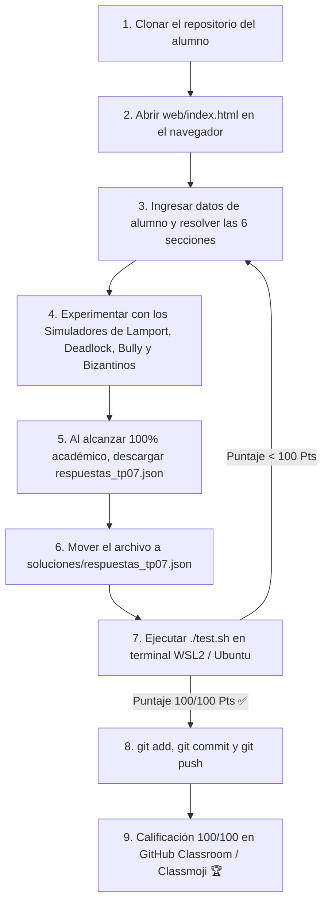

# Trabajo Práctico N° 7: Coordinación Distribuida

> **Universidad Nacional de Jujuy (UNJu)**  
> **Facultad de Ingeniería — Departamento de Informática**  
> **Cátedra:** Sistemas Operativos II — Ciclo Lectivo 2026  
> **Equipo Docente:** Ing. María Fernanda Vázquez (Titular) | Ing. Fabio Damián Argañaraz Azua (JTP)  
> **Plataformas:** WSL2 (Ubuntu 24.04) | GitHub Classroom | Classmoji  
> **Modalidad:** Individual / Autoevaluativo con Autograding Criptográfico  
> **Estructura Pedagógica:** 100% Laboratorio Web Interactivo con Simuladores de Relojes Lógicos, Prevención de Interbloqueo, Elección Bully y Consenso Bizantino  

---

## 🎯 Objetivos de Aprendizaje

1. **Comprender la Problemática de los Estados Globales en Sistemas Distribuidos:** Asimilar por qué la ausencia de memoria compartida y los retardos de transmisión en red impiden observar un estado instantáneo global único sin un protocolo coordinado de instantáneas (*snapshots*).
2. **Dominar los Relojes Lógicos de Lamport:** Aplicar la relación causal "ocurrió antes" (*happened-before*, $a \to b$), las reglas de sincronización en emisión ($C_i \leftarrow C_i + 1$) y recepción ($C_j \leftarrow 1 + \max[C_j, T_i]$), y el desempate por identificador de nodo para establecer una ordenación total estricta.
3. **Analizar los Algoritmos de Exclusión Mutua Distribuida:** Evaluar los compromisos técnicos (*trade-offs*) entre el enfoque centralizado (SPOF y cuello de botella), el enfoque distribuido de Ricart y Agrawala ($2(N-1)$ mensajes y tolerancia a fallos) y el paso de testigo en anillo (*token ring*).
4. **Distinguir entre Interbloqueo Real y Fantasma:** Comprender cómo los retardos en los canales de comunicación pueden generar reportes de interbloqueos falsos (*phantom deadlocks*) y estudiar el algoritmo de detección distribuida por difusión de sondas de Chandy-Misra-Haas.
5. **Implementar Esquemas Preventivos de Interbloqueo:** Comparar las políticas de asignación de recursos basadas en marcas de tiempo: **Esperar-Morir (Wait-Die)** *(no apropiativo)* frente a **Herir-Esperar (Wound-Wait)** *(apropiativo)*.
6. **Simular Algoritmos de Elección de Líder:** Examinar la detección de fallas por temporizador ($2T_p + T_t$), la dinámica de imposición del **Algoritmo Bully** de García-Molina y la recolección de listas en el **Algoritmo del Anillo** de Chang y Roberts.
7. **Modelar el Consenso Distribuido y el Problema de los Generales Bizantinos:** Diferenciar fallas de parada (*Crash*) de fallas bizantinas (*Arbitrarias/Maliciosas*), validar las condiciones de consistencia (IC1 e IC2) y calcular las cotas teóricas de tolerancia para **Mensajes Orales ($n > 3m$)** y **Mensajes Firmados ($n > m+1$)**.
8. **Autoevaluación Criptográfica y Entrega Automatizada:** Ejecutar la suite `./test.sh` y el evaluador Zero-Knowledge `autograder_tp07.py` para validar la calificación (100/100 Pts) antes de enviar a GitHub Classroom.

---

## 📂 Estructura del Repositorio

```text
TP07/
├── .github/
│   └── workflows/
│       └── classroom.yml          # Workflow de CI en GitHub Actions / Classmoji (Python 3.11)
├── soluciones/
│   ├── .gitkeep                   # Mantiene la carpeta en Git
│   └── respuestas_tp07.json.template # Plantilla JSON de referencia
├── web/                           # Módulo Web Interactivo con Simuladores Embebidos
│   ├── index.html                 # Aplicación web con Drag & Drop, switches, selectores y simuladores
│   ├── styles.css                 # Estilos Glassmorphism en modo oscuro/claro
│   └── app.js                     # Motor reactivo, simuladores, persistencia y exportador JSON
├── test.sh                        # Suite de validación local (0 a 100 Pts) con diagnóstico ANSI
├── autograder_tp07.py              # Evaluador criptográfico en Python 3 (Zero-Knowledge)
├── rubric_tp07.json                # Rúbrica pública protegida con hashes SHA-256
├── rubric_tp07_master.json         # Rúbrica maestra docente (en .gitignore)
├── CHEATSHEET.md                  # Resumen rápido de conceptos, fórmulas y tablas comparativas
├── .gitattributes                 # Normalización de saltos de línea LF (Unix)
├── .gitignore                     # Exclusión de claves master y temporales de Python
└── README.md                      # Enunciado y guía metodológica paso a paso
```

> [!IMPORTANT]
> **El archivo de entrega es generado por la aplicación web:** Al clonar este repositorio, la carpeta `soluciones/` **no contiene** el archivo `respuestas_tp07.json` (solo la plantilla `.template`). Deberá generarlo resolviendo el laboratorio interactivo en su navegador (`web/index.html`).

---

## 🚀 Flujo Metodológico de Trabajo



---

## 🧪 Guía Paso a Paso para la Realización del Trabajo Práctico

### Paso 1: Clonar y verificar el estado inicial de la suite

Abra su terminal en **WSL2 (Ubuntu 24.04)**, ingrese al repositorio clonado y otorgue permisos de ejecución a la suite de pruebas:

```bash
chmod +x test.sh autograder_tp07.py
./test.sh
```

#### Qué debería mostrar por consola (`Salida Inicial 0/100 Pts`):
```text
================================================================
     UNJu — SISTEMAS OPERATIVOS II — EVALUACIÓN AUTOMÁTICA TP 7   
     Tema: Coordinación Distribuida — Módulo Web Interactivo      
================================================================

Verificando Módulo Web Interactivo (soluciones/respuestas_tp07.json)...
  ✗ Falta el archivo 'soluciones/respuestas_tp07.json'.
  ℹ Pasos para completar el trabajo práctico:
    1. Abra 'web/index.html' en su navegador web preferido.
    2. Ingrese sus datos (Nombre, Legajo, GitHub).
    3. Resuelva los laboratorios interactivos (Lamport, Exclusión Mutua, Wait-Die/Wound-Wait, Bully/Anillo y Bizantinos).
    4. Al alcanzar el 100% académico, haga clic en '📥 Descargar respuestas_tp07.json'.
    5. Mueva el archivo descargado a la carpeta 'soluciones/' de este repositorio.
    6. Vuelva a ejecutar './test.sh'.

  ✗ [FAIL] Módulo Web no entregado (+0 Pts)

================================================================
                       RESUMEN DE CALIFICACIÓN                  
================================================================
  PUNTAJE FINAL: 0 / 100 Pts (0%)
  ESTADO: TP 7 INCOMPLETO — Requiere atención antes de la entrega ⚠️
================================================================
```

---

### Paso 2: Resolver el Laboratorio en la Aplicación Web (`web/index.html`)

Abra el archivo `web/index.html` en su navegador (Google Chrome, Firefox o Edge). La interfaz cuenta con:

1. **Datos del Estudiante:** Ingrese su Nombre, Legajo (LU) y usuario de GitHub.
2. **Sticky Toolbar Superior:** Monitoriza en tiempo real su porcentaje de avance académico ($0\%$ a $100\%$) y la cantidad de ítems resueltos ($0/31$).
3. **Paneles Bibliográficos Desplegables (`📖 Dónde estudiar este tema...`):** En cada sección, consulte los capítulos y diapositivas oficiales recomendados.
4. **Laboratorios y Simuladores Interactivos:**
   - **Simulador 1 (Relojes de Lamport):** Genere eventos locales y mensajes entre procesos ($P_1, P_2, P_3$) y observe cómo se propagan las marcas de tiempo aplicando $C_j \leftarrow 1 + \max(C_j, T_i)$.
   - **Simulador 2 (Wait-Die vs Wound-Wait):** Configure marcas de tiempo de transacciones $T_{req}$ y $T_{hold}$ y observe de forma dinámica si la transacción espera, muere o hiere a la titular.
   - **Simulador 3 (Algoritmos de Elección Bully / Anillo):** Simule la caída del coordinador y visualice la propagación de mensajes `ELECCION`, `OK` y proclamación de nuevo líder.
   - **Simulador 4 (Consenso de Generales Bizantinos):** Modifique el número de traidores ($m$) y compruebe matemáticamente si el sistema cumple las cotas teóricas $n > 3m$ (Orales) o $n > m+1$ (Firmados).
5. **Descarga de Respuestas:** Al completar el $100\%$ de los ítems académicos y haber completado sus datos personales, se habilitará el botón **📥 Descargar respuestas_tp07.json**.

---

### Paso 3: Ubicar el archivo y validar localmente

Mueva el archivo descargado desde su carpeta de Descargas a la carpeta `soluciones/` del repositorio:

```bash
# Ejemplo en WSL2:
mv /mnt/c/Users/<TuUsuario>/Downloads/respuestas_tp07.json soluciones/
```

Vuelva a ejecutar `./test.sh` en su terminal:

```bash
./test.sh
```

#### Qué debería mostrar por consola (`Salida Final 100/100 Pts`):
```text
================================================================
     UNJu — SISTEMAS OPERATIVOS II — EVALUACIÓN AUTOMÁTICA TP 7   
     Tema: Coordinación Distribuida — Módulo Web Interactivo      
================================================================

Verificando Módulo Web Interactivo (soluciones/respuestas_tp07.json)...
  ℹ Ejecutando autograder_tp07.py sobre 'soluciones/respuestas_tp07.json'...
========================================================================
   UNJu — FACULTAD DE INGENIERÍA — SISTEMAS OPERATIVOS II (2026)
   EVALUADOR AUTOMÁTICO: TRABAJO PRÁCTICO N° 7 (COORDINACIÓN DISTRIBUIDA)
========================================================================
Estudiante : PÉREZ JUAN
Legajo     : 45890
GitHub     : juanperez-unju
Fecha      : 2026-11-01T15:30:00
------------------------------------------------------------------------
Sección / Ejercicio Evaluado                         | Puntaje        
------------------------------------------------------------------------
Sección 1: Estados Globales, Instantáneas y Reloje   | 16.0 / 16 Pts ✓ [OK]
Sección 2: Algoritmos de Exclusión Mutua Distribui   | 16.0 / 16 Pts ✓ [OK]
Sección 3: Matriz de Interbloqueo Distribuido y Pr   | 18.0 / 18 Pts ✓ [OK]
Sección 4: Laboratorio Interactivo de Algoritmos d   | 16.0 / 16 Pts ✓ [OK]
Sección 5: Secuencia Operativa del Algoritmo de El   | 16.0 / 16 Pts ✓ [OK]
Sección 6: Consenso Distribuido y Problema de los    | 18.0 / 18 Pts ✓ [OK]
========================================================================
PUNTAJE TOTAL OBTENIDO : 100.0 / 100 Pts (100.0%)
RESULTADO FINAL        : ¡APROBADO AL 100%! EXCELENTE TRABAJO 🎉
========================================================================

  ✓ [PASS] Módulo Web validado al 100% con autograder_tp07.py (+100 Pts)

================================================================
                       RESUMEN DE CALIFICACIÓN                  
================================================================
  PUNTAJE FINAL: 100 / 100 Pts (100%)
  ESTADO: ¡FELICITACIONES! TP 7 COMPLETADO EXITOSAMENTE ✅
================================================================
```

---

### Paso 4: Entrega en GitHub Classroom

Una vez obtenido el puntaje de **100/100 Pts**, confirme y envíe sus cambios al repositorio remoto:

```bash
git status
git add soluciones/respuestas_tp07.json
git commit -m "Entrega Trabajo Práctico N° 7 - 100 Pts completados"
git push origin main
```

El flujo de GitHub Actions ejecutará automáticamente la verificación en la nube y sincronizará su nota en la plataforma **Classmoji** (`app.classmoji.io`).

---

## 📚 Mapeo Bibliográfico Obligatorio de Cátedra

| Tema del Trabajo Práctico | Diapositivas Titular (Ing. Vázquez) | Silberschatz (7ma Ed.) | Carretero (Visión Aplicada) | Tanenbaum (Modernos / Distribuidos) | Stallings |
| :--- | :--- | :--- | :--- | :--- | :--- |
| **Estados Globales e Instantáneas** | U7: Slides 3–5 | Cap. 18 (Secc. 18.1–18.2) | Cap. 11 (Secc. 11.1) | Cap. 6 (Sistemas Distribuidos) | Cap. 14 |
| **Relojes Lógicos de Lamport** | U7: Slides 6–11 | Cap. 18 (Secc. 18.1) | Cap. 11 (Secc. 11.2) | Cap. 6 (Sistemas Distribuidos) | Cap. 14 |
| **Exclusión Mutua Distribuida** | U7: Slides 12–22 | Cap. 18 (Secc. 18.2) | Cap. 11 (Secc. 11.3) | Cap. 6 (Sistemas Distribuidos) | Cap. 14 |
| **Interbloqueo Distribuido** | U7: Slides 23–29 | Cap. 18 (Secc. 18.3) | Cap. 11 (Secc. 11.4) | Cap. 6 (Sistemas Distribuidos) | Cap. 14 |
| **Algoritmos de Elección (Bully y Anillo)** | U7: Slides 30–36 | Cap. 18 (Secc. 18.5) | Cap. 11 (Secc. 11.5) | Cap. 6 (Sistemas Distribuidos) | Cap. 14 |
| **Consenso y Generales Bizantinos** | U7: Slides 37–44 | Cap. 18 (Secc. 18.6) | Cap. 11 (Secc. 11.6) | Cap. 8 (Tolerancia a Fallas) | Cap. 14 |

